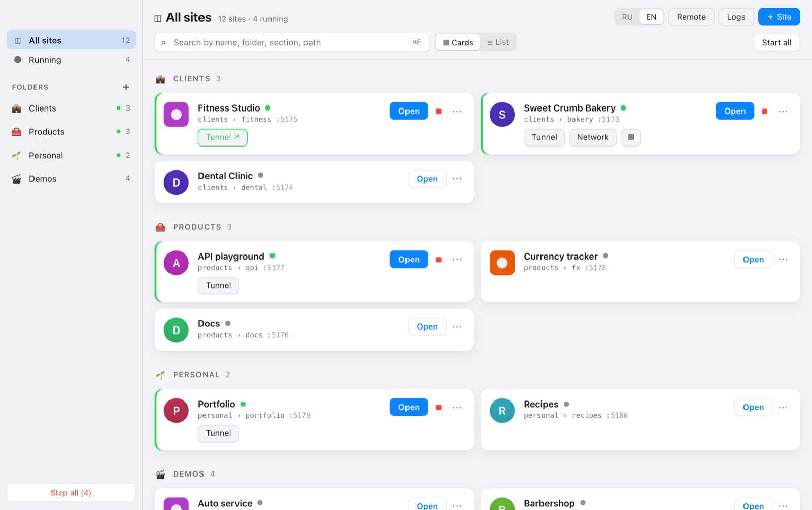
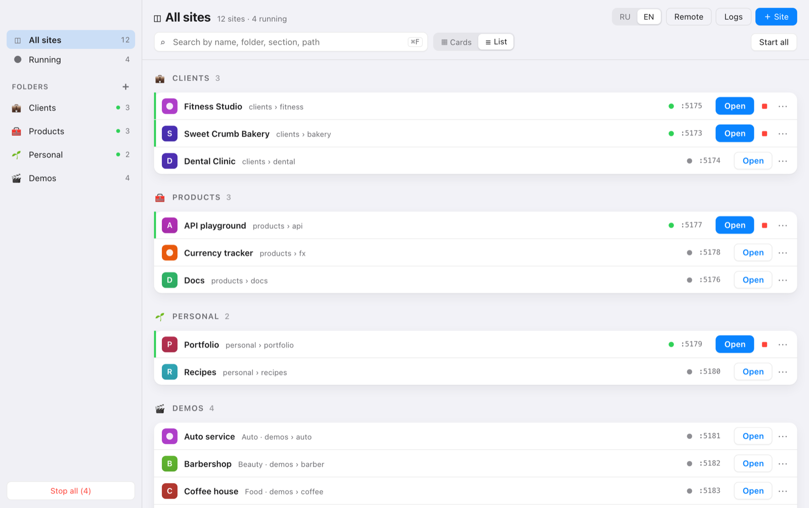

# SiteDock

**English** · [Русский](README.ru.md)

A small macOS app (Electron, menu bar) that keeps all your local sites in one place. Add a folder, and SiteDock serves
it on its own port with live reload. It can open it on your phone over Wi-Fi with a QR code, or share it on the
internet through a cloudflared tunnel. It also runs small apps (`npm start`), not only static files. The interface is
in Russian and English.



## What it does

- **Sites by folders.** A sidebar with *All sites*, *Running*, your folders, *No folder* and *Archive*. Drag a card onto a folder; drag folders to reorder them. Sections group the sites inside a folder. Search by name, folder, section, path or port (⌘F). View them as cards or as a compact list.
- **One port per site.** The port starts at 5173, is remembered and can be changed. A busy port gives a clear error and offers the next free one.
- **Each site's options.** SPA mode (any 404 serves `index.html`), live reload (the tab reloads when files change), autostart.
- **Apps as well as static files.** A site can be a command (`npm start`, `node server.js`). SiteDock runs it with its own `PORT` and proxies requests to it, WebSockets included.
- **On the phone.** «Network» makes the site listen on the LAN. The link and QR code carry the site's access key, so other devices on the Wi-Fi cannot open it without the link.
- **On the internet.** A cloudflared quick tunnel gives a public link. The key is required by default; a site that is public anyway can open its tunnel to everyone.
- **A remote for another computer.** A small page on your network starts and stops sites. It opens with a password or a link with a key.
- **The rest.** A request log for every site, a menu-bar icon with the number of running sites, favicons found automatically, and «Show in Finder» / «Open in VS Code».
- **Two languages.** Russian or English, switched in the toolbar. By default it follows the macOS language.



## Security

SiteDock serves folders from your disk and can run commands, so these checks are built in:

| Risk | What SiteDock does |
|---|---|
| A web page in your browser reaching `127.0.0.1` through DNS rebinding | Only `localhost` and IP addresses are accepted in `Host`. The only domain accepted is the open tunnel's own name. |
| Another device on your Wi-Fi | Anything not from this Mac needs the site key. The key arrives once in the link (`?k=`) and then lives in an `HttpOnly` cookie. |
| The tunnel (cloudflared connects from `127.0.0.1`) | The key is still required: a tunnel request is detected by its Host. This includes live reload's WebSocket. |
| Hidden files and symlinks | `.env`, `.git` and other dot-paths are never served (except `.well-known`). Symlinks are not followed. |
| A command site's own server | It gets `HOST=127.0.0.1` and is reached only through SiteDock's port and gate. SiteDock's key cookie is removed before the request goes to the app. |
| A web page sending requests to the remote (CSRF) | Changes are accepted only with an `X-SiteDock: 1` header, which another page cannot add without a CORS preflight, and only with the page's own `Origin`. |
| The remote's password | Typed by hand on another computer, so guessing is slowed down: 5 wrong attempts lock it for a minute. |
| The renderer | `contextIsolation`, `sandbox` and a strict CSP. Navigation never leaves the app; external links open in the browser. |

## Install and run

You need macOS (Apple Silicon), Node 22.18+ and pnpm.

```bash
pnpm install
pnpm dev          # run in development
pnpm build:dir    # build SiteDock.app into release.noindex/mac-arm64/
pnpm build        # build a .dmg
```

The app is not signed (`identity: null`). On the first launch, macOS asks you to allow it in
System Settings → Privacy & Security.

For tunnels you also need cloudflared: `brew install cloudflared`.

## Checks

```bash
pnpm typecheck
pnpm test        # node:test, no extra packages
```

The tests cover:
- **The gate:** Host, the site key, the tunnel, live reload and the remote's CSRF rule.
- **Translations:** every Russian text in the code has an English one with the same `{params}`, and no Russian text is left outside `t()`.

CI runs the same steps on macOS on every push.

## How it is built

```
src/
├─ shared/        types (main ↔ renderer), i18n (t(), the English dictionary, plural forms)
├─ main/          all disk and network work
│  ├─ server/     SiteServer (http + ws + chokidar), the gate (access.ts), proxy, live-reload injection, tunnel
│  ├─ remote/     the remote page for another computer (its own server, password or key)
│  ├─ ipc.ts      the only place with ipcMain.handle
│  ├─ store.ts    electron-store: sites, folders, the remote, the language
│  └─ tray.ts     the menu-bar icon
├─ preload/       contextBridge — the only bridge
└─ renderer/      React; knows nothing about fs or net
scripts/relocate-sites.mjs   moved your site folders? rewrite their paths (quit SiteDock first)
```

## How it was made

I designed and use SiteDock myself. The code was written together with
[Claude Code](https://claude.com/claude-code) as a pair programmer: I set the tasks and the security rules, then
reviewed and checked the result. It started as a personal tool; this public copy has a clean history, without
personal data.

## License

[MIT](LICENSE)
