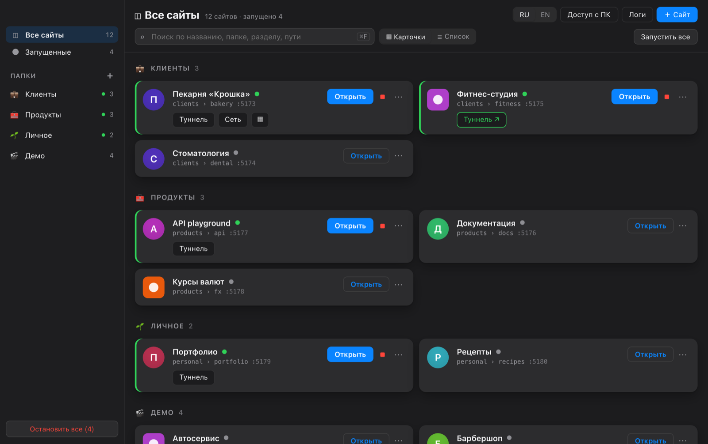

# SiteDock

[English](README.md) · **Русский**

Небольшое приложение для macOS (Electron, живёт в строке меню), в котором собраны все ваши локальные сайты. Добавляете
папку, и SiteDock раздаёт её на своём порту с live reload. Сайт можно открыть на телефоне по Wi-Fi через QR-код или
показать в интернете через туннель cloudflared. SiteDock запускает и небольшие приложения (`npm start`), а не только
статику. Интерфейс на русском и английском.



## Что умеет

- **Сайты по папкам.** Слева «Все сайты», «Запущенные», ваши папки, «Без папки» и «Архив». Карточку можно перетащить на папку, а папки — поменять местами. Внутри папки сайты делятся на разделы. Поиск по названию, папке, разделу, пути и порту (⌘F). Вид — карточки или компактный список.
- **У каждого сайта свой порт.** Нумерация с 5173, порт запоминается и меняется. Если порт занят, будет понятная ошибка и предложение взять следующий свободный.
- **Настройки сайта.** SPA-режим (любой 404 отдаёт `index.html`), live reload (вкладка перезагружается, когда меняются файлы), автозапуск.
- **Не только статика.** Сайт может быть командой (`npm start`, `node server.js`). SiteDock запускает её со своим `PORT` и проксирует запросы, включая WebSocket.
- **На телефоне.** Кнопка «Сеть» открывает сайт в локальной сети. Ссылка и QR-код содержат ключ сайта, так что без ссылки другие устройства в той же Wi-Fi его не откроют.
- **В интернете.** Быстрый туннель cloudflared даёт публичную ссылку. По умолчанию для неё нужен ключ; если сайт и так публичный, туннель можно открыть для всех.
- **Пульт для другого компьютера.** Маленькая страница в вашей сети, где можно запускать и останавливать сайты. Вход по паролю или по ссылке с ключом.
- **Остальное.** Журнал запросов по всем сайтам, значок в строке меню с числом запущенных, иконки сайтов находятся сами, кнопки «Показать в Finder» и «Открыть в VS Code».
- **Два языка.** Русский или английский, переключатель на панели. По умолчанию — как язык macOS.

## Безопасность

SiteDock раздаёт папки с диска и умеет запускать команды, поэтому в нём есть такие проверки:

| Риск | Что делает SiteDock |
|---|---|
| Страница в браузере добирается до `127.0.0.1` через DNS rebinding | В `Host` принимаются только `localhost` и IP-адреса. Из доменов — только имя открытого туннеля. |
| Другое устройство в вашей Wi-Fi | Всё, что не с этого Mac, требует ключ сайта. Ключ приходит один раз в ссылке (`?k=`), дальше хранится в `HttpOnly`-cookie. |
| Туннель (cloudflared подключается с `127.0.0.1`) | Ключ всё равно нужен: запрос из туннеля узнаётся по Host. Это относится и к WebSocket для live reload. |
| Скрытые файлы и симлинки | `.env`, `.git` и другие пути с точкой не отдаются (кроме `.well-known`). По симлинкам SiteDock не переходит. |
| Собственный сервер сайта-команды | Получает `HOST=127.0.0.1`, снаружи доступен только через порт SiteDock и его проверки. Cookie с ключом SiteDock до приложения не доходит. |
| Чужая страница шлёт запросы пульту (CSRF) | Изменения принимаются только с заголовком `X-SiteDock: 1` (чужая страница не может добавить его без CORS-preflight) и только со своим `Origin`. |
| Пароль пульта | Его набирают руками на другом компьютере, поэтому подбор замедлен: после 5 неверных попыток вход закрывается на минуту. |
| Окно приложения | `contextIsolation`, `sandbox` и строгий CSP. Окно никуда не уходит со своей страницы, внешние ссылки открываются в браузере. |

## Установка и запуск

Нужны macOS (Apple Silicon), Node 22.18+ и pnpm.

```bash
pnpm install
pnpm dev          # запуск для разработки
pnpm build:dir    # SiteDock.app в release.noindex/mac-arm64/
pnpm build        # .dmg
```

Приложение не подписано (`identity: null`). При первом запуске macOS попросит разрешить его в
«Системные настройки → Конфиденциальность и безопасность».

Для туннелей нужен cloudflared: `brew install cloudflared`.

## Проверки

```bash
pnpm typecheck
pnpm test        # node:test, без дополнительных пакетов
```

Что проверяют тесты:
- **Проверки доступа:** Host, ключ сайта, туннель, live reload и правило против CSRF у пульта.
- **Перевод:** у каждой русской строки в коде есть английская с теми же `{параметрами}`, и вне `t()` не осталось русского текста.

CI повторяет то же на macOS при каждом push.

## Как устроено

```
src/
├─ shared/        типы (main ↔ renderer), i18n (t(), английский словарь, формы множественного числа)
├─ main/          вся работа с диском и сетью
│  ├─ server/     SiteServer (http + ws + chokidar), проверки доступа (access.ts), прокси, live reload, туннель
│  ├─ remote/     страница пульта для другого компьютера (свой сервер, пароль или ключ)
│  ├─ ipc.ts      единственное место с ipcMain.handle
│  ├─ store.ts    electron-store: сайты, папки, пульт, язык
│  └─ tray.ts     значок в строке меню
├─ preload/       contextBridge — единственный мост
└─ renderer/      React, ничего не знает о fs и сети
scripts/relocate-sites.mjs   перенесли папки сайтов? Скрипт перепишет пути (сначала закройте SiteDock)
```

## Как сделано

SiteDock я придумал сам и сам им пользуюсь. Код писался вместе с [Claude Code](https://claude.com/claude-code) в роли
напарника: я ставил задачи и правила безопасности, проверял и принимал результат. Приложение выросло из личного
инструмента; эта публичная копия начата с чистой историей, без личных данных.

## Лицензия

[MIT](LICENSE)
